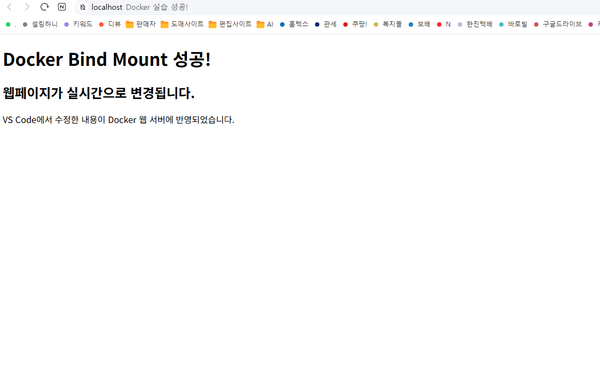

# 개발 워크스테이션 구축

## 1. 프로젝트 개요
Windows, Linux CLI, Docker, Git/GitHub를 이용하여 재현 가능한 개발 환경을 구축하고 검증한 프로젝트입니다.

## 2. 실행 환경
- OS: Windows + Docker Linux 컨테이너
- Terminal: Windows PowerShell
- Docker: evidence/docker-log.txt 참고
- Git: evidence/git-log.txt 참고

## 3. 수행 체크리스트
- [x] 터미널 기본 명령어 실습
- [x] 파일 및 디렉토리 권한 변경
- [x] Docker 설치 및 점검
- [x] hello-world 및 Ubuntu 컨테이너 실행
- [x] Dockerfile 기반 웹 서버 이미지 빌드
- [x] 포트 매핑 및 웹 접속
- [x] 바인드 마운트 변경 반영
- [x] Docker 볼륨 영속성 검증
- [x] Git 및 GitHub 연동

## 4. 실행 및 검증
웹 서버 이미지 빌드:

```powershell
docker build -t my-web:1.0 .
docker run -d --name my-web-8081 -p 8081:80 my-web:1.0
curl.exe http://localhost:8081
```

포트 매핑은 호스트의 8081 포트를 컨테이너의 80 포트에 연결합니다.

### 웹 접속 증거


### 실습 로그
- [Docker 점검 및 운영](evidence/docker-log.txt)
- [Linux 터미널 및 권한](evidence/terminal-log.txt)
- [Docker 이미지 빌드](evidence/docker-build-log.txt)
- [웹 서버 실행](evidence/web-8081-log.txt)
- [바인드 마운트 변경 전후](evidence/bind-mount-log.txt)
- [볼륨 영속성](evidence/volume-log.txt)
- [Git 연동](evidence/git-log.txt)

## 5. 트러블슈팅
### 문제 1: 8080 포트 충돌
- 문제: Docker 실행 중 port is already allocated 오류 발생
- 원인 가설: 기존 프로그램 또는 컨테이너가 8080 포트를 사용 중
- 확인: Docker 실행 오류 메시지 확인
- 해결: 호스트 포트를 8081로 변경하여 실행

### 문제 2: 한글 출력 깨짐
- 문제: PowerShell 로그에서 한글이 깨져 표시됨
- 원인 가설: Windows 콘솔과 파일의 문자 인코딩 불일치
- 확인: web-log.txt의 한글 출력 확인
- 개선 방법: UTF-8 인코딩을 사용하고 출력 환경을 통일

## 6. 기술 개념
절대 경로는 C:\Users처럼 시작 위치가 정해진 경로이며, 상대 경로는 현재 디렉토리를 기준으로 합니다.

Linux 권한 r은 읽기, w는 쓰기, x는 실행을 뜻합니다. 755는 소유자 rwx, 그룹과 기타 사용자 r-x이며, 644는 소유자 rw-, 나머지 r--입니다.

Docker 이미지는 실행 환경의 템플릿이고 컨테이너는 그 이미지를 실행한 인스턴스입니다.

바인드 마운트는 호스트 파일 변경을 컨테이너에 반영하고, Docker 볼륨은 컨테이너 삭제 후에도 데이터를 유지합니다.

Git은 로컬 버전 관리 도구이고 GitHub는 원격 저장소 및 협업 플랫폼입니다.
